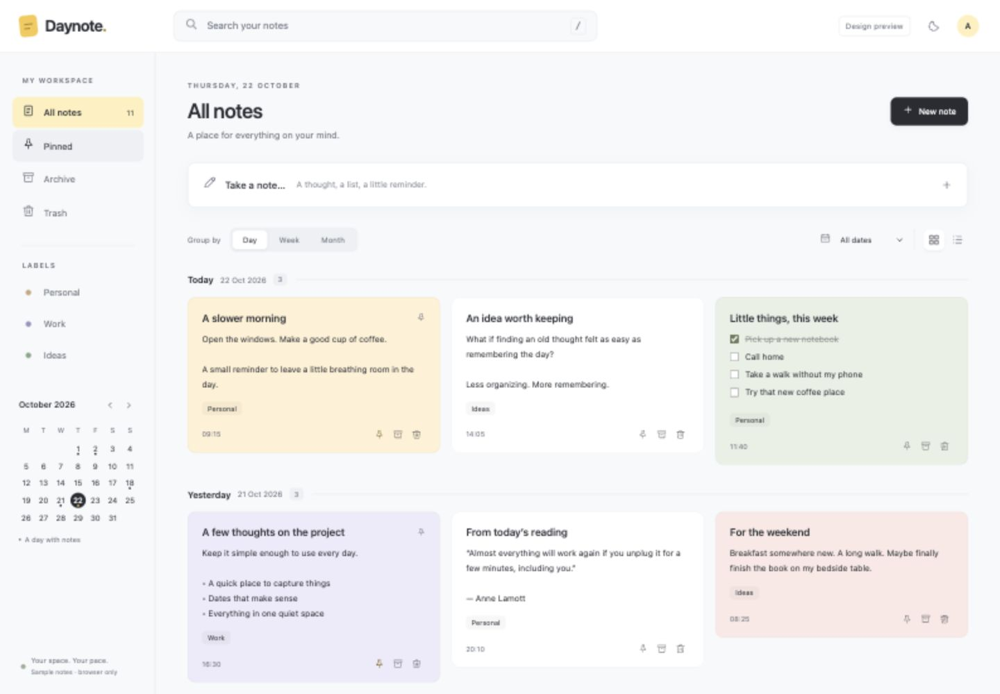

# Daynote

A personal note-taking app for Raspberry Pi, inspired by Google Keep. Capture text and checklists, then find them again by day, week, or month.



## Features

- Responsive note cards, list/grid layouts, and light/dark appearance.
- Day, Monday-start week, and month grouping with date filters and calendar navigation.
- Search across titles, note text, and checklists.
- Labels, colors, pinned notes, archive, trash, and restore.
- SQLite persistence, confirmed autosave, retry protection, and revision conflicts that preserve both versions.
- Best-effort recovery of unsaved drafts in the current browser.
- JSON export and Markdown ZIP export.
- Docker deployment, automatic restart, and consistent daily/weekly backups.

The supplied deployment enables **personal mode**: the app opens directly without a setup code or password. Anyone who can reach its address can view and edit the notes. It is intended for a trusted private network, with no public port forwarding. HTTPS and remote access are not included.

## Run on a Raspberry Pi

Requires a Raspberry Pi with a 64-bit OS, Docker, and Docker Compose. The app has been tested on a Raspberry Pi 5 with Debian 12 / ARM64.

```sh
git clone https://github.com/ajmalrasi/note-app.git
cd note-app
```

Before starting, edit `deployment/compose.yaml` for your Pi's LAN address:

- Replace `192.168.3.20` in the port binding and `DAYNOTE_ALLOWED_HOSTS` with your Pi's address.
- Keep port `8240`, or update both the port binding and allowed host entries if you choose another external port.
- Keep `127.0.0.1:8240` in the allowed host list for the container health check.

Create the persistent data directory with the container user's ownership, then start the app:

```sh
cd deployment
sudo install -d -m 700 -o 10001 -g 10001 data
docker compose up -d --build
docker compose ps
```

Open `http://YOUR_PI_ADDRESS:8240` from a device on the same network. The app starts empty; the fictional notes in the design preview are separate.

The database lives in `deployment/data/daynote.sqlite3`. Preserve this directory when updating or replacing the container. The source repository excludes databases, runtime credentials, and backups.

## Backups

Create a consistent SQLite snapshot manually:

```sh
docker exec daynote python /app/server.py backup
```

To enable the supplied nightly schedule on a Linux host using systemd:

```sh
sudo install -m 644 daynote-backup.service /etc/systemd/system/
sudo install -m 644 daynote-backup.timer /etc/systemd/system/
sudo systemctl daemon-reload
sudo systemctl enable --now daynote-backup.timer
sudo systemctl start daynote-backup.service
systemctl list-timers daynote-backup.timer
```

Backups run around 03:15 India time, retaining seven daily copies and four Monday weekly copies under `data/backups/`. Copy backups or download exports to another device as well; copies on the same Pi do not protect against storage failure.

To restore, stop the app, preserve the current entire data directory, and place a consistent backup into a fresh data directory as `daynote.sqlite3`, owned by UID/GID 10001 with mode 600. Then start the app and verify representative notes. Do not mix a restored database with old WAL/journal files.

## Development and tests

The interface is plain HTML/CSS/JavaScript. The backend uses Python/FastAPI and SQLite; there is no frontend build step.

```sh
python3 -m venv .venv
.venv/bin/pip install -r app/requirements-dev.txt
DAYNOTE_DATA="$PWD/.local-data" DAYNOTE_PERSONAL_MODE=true \
  .venv/bin/uvicorn server:create_app --factory --app-dir app \
  --host 127.0.0.1 --port 8240 --no-proxy-headers
.venv/bin/pytest app/tests/test_server.py -q
```

Use Python 3.12 for the same runtime as the Docker image. Runtime dependencies are pinned in `app/requirements.lock`.

The current suite has 17 passing checks covering access modes, request protection, date boundaries, immutable creation dates, retry idempotency, conflicts, checklists, retrieval, trash/restore, exports, pagination, and backup restoration. `app/tests/pi_smoke.py` is an integration exercise for a disposable container named `daynote-staging`; it must not be pointed at a real notes database.

## Project layout

| Path | Contents |
| --- | --- |
| `app/server.py` | API, SQLite storage, optional authentication, and backup command |
| `app/static/` | Live application interface |
| `app/tests/` | Automated checks and disposable Pi integration exercise |
| `deployment/` | Docker Compose and nightly backup units |
| `design/` | Standalone interactive prototype and design screenshots |
| `01-product-analysis.md` | Original product requirements and date behavior |
| `02-technical-and-delivery-plan.md` | Initial technical proposal; some choices changed during implementation |
| `04-research-sources.md` | Research references |
| `05-design-guide.md` | Prototype review guide |

Open `design/daynote-preview.html` directly in a browser to explore the original design with fictional notes. It is separate from the live app and uses browser storage only.

Current limits: one shared personal workspace, India-time creation dates, three preset label choices, no attachments, no complete offline sync, and page-based retrieval. Refresh before continuing deep pagination after changes from another device.
